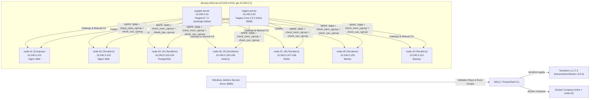

# Intelligent Server Health Monitoring & Automated Configuration Management System

A multi-tier local DevOps infrastructure providing declarative container provisioning (Terraform), automated role-based configuration management (Puppet 8), cgroup-aware centralized monitoring (Nagios Core 4.5.2 + NRPE), and CI/CD validation (Windows Jenkins Service).

---

## Architecture Overview



---

## Technology Stack

| Layer | Technology | Version / Details |
| :--- | :--- | :--- |
| **Host & Runtime** | Windows 11 + WSL2 + Docker Desktop | 16 GB laptop (~7.61 GiB Docker VM, 12 CPUs) |
| **IaC Provisioning** | Terraform (`kreuzwerker/docker`) | Terraform `v1.17.2`, provider `v3.9.0` |
| **Config Management** | Puppet Server & Puppet Agent | Server `8.7.0`, Agent `8.10.0`, `autosign = false` |
| **Monitoring** | Nagios Core & NRPE | Nagios `4.5.2`, custom `check_mem_cgroup` & `check_cpu_cgroup` |
| **CI/CD** | Jenkins (Windows Service) | Local Windows Service (`jenkins/Jenkinsfile`) |
| **Managed Node OS** | Ubuntu 24.04.5 LTS (`custom-ubuntu24-managed-node:monitoring-v2.1`) | Supervisor PID 1 (`sshd`, `nrpe`, `puppet-agent`) |

---

## Network, IP Allocation & Ownership Boundaries

- **Docker Network:** `devops-infra-net` (`10.240.0.0/16`, Gateway `10.240.0.1`, owned by Docker Compose; referenced read-only via `data.docker_network` in Terraform).
- **Jenkins:** Runs natively as a Windows Service outside Docker.

| Host / Container | IPv4 Address | Role | Owner | Memory / CPU Limit |
| :--- | :--- | :--- | :--- | :--- |
| `puppet-server` | `10.240.0.10` | Puppet Master & CA | Docker Compose | 1024 MiB / 1.50 CPU |
| `nagios-server` | `10.240.0.20` | Nagios Core & Apache UI (`:8085`) | Docker Compose | 512 MiB / 0.50 CPU |
| `node-01` | `10.240.0.101` | Nginx Web Server | Docker Compose | 512 MiB / 1.00 CPU |
| `node-02` | `10.240.0.102` | Nginx Web Server | Terraform | 256 MiB / 0.50 CPU |
| `node-03` | `10.240.0.103` | PostgreSQL Database | Terraform | 512 MiB / 1.00 CPU |
| `node-04` | `10.240.0.104` | PostgreSQL Database | Terraform | 512 MiB / 1.00 CPU |
| `node-05` | `10.240.0.105` | Node.js Application | Terraform | 384 MiB / 0.75 CPU |
| `node-06` | `10.240.0.106` | Node.js Application | Terraform | 384 MiB / 0.75 CPU |
| `node-07` | `10.240.0.107` | Redis Cache | Terraform | 256 MiB / 0.50 CPU |
| `node-08` | `10.240.0.108` | Redis Cache | Terraform | 256 MiB / 0.50 CPU |
| `node-09` | `10.240.0.109` | Background Worker | Terraform | 256 MiB / 0.50 CPU |
| `node-10` | `10.240.0.110` | Backup Node | Terraform | 256 MiB / 0.50 CPU |

---

## Repository Structure

```text
Devops_Project/
├── .dockerignore
├── .env.example
├── .gitignore
├── README.md
├── docker/
│   ├── build/
│   │   ├── managed-node/       # Ubuntu 24.04 + Puppet 8 + NRPE + cgroup plugins
│   │   ├── nagios/             # Nagios Core 4.5.2 + host configs (node-01..node-10)
│   │   └── puppet-server/      # Puppet Server 8.7.0
│   └── compose/                # Compose-managed infra & node-01
├── terraform/                  # Manages node-02..node-10 only
│   └── modules/managed_nodes/
├── puppet/                     # Puppet Server config, site.pp, and 7 role modules
├── jenkins/                    # Declarative Jenkinsfile & Windows service docs
├── scripts/                    # verify-phase1.ps1 .. verify-phase4.ps1
└── extensions/k3s/             # Future extension placeholder
```

---

## Component Workflows

### 1. Terraform Provisioning (`node-02`–`node-10`)
```bash
cd /mnt/d/Devops_Project/terraform
terraform fmt -check -recursive
terraform init
terraform validate
terraform plan
terraform apply
```
* Uses local image `custom-ubuntu24-managed-node:monitoring-v2.1` via `data.docker_image` (no remote pull).
* Local state (`terraform.tfstate`) is excluded by `.gitignore`; `.terraform.lock.hcl` is tracked.

### 2. Puppet Configuration Management
* `autosign = false` in `puppet/puppet.conf`; CSRs are verified and signed manually on `puppet-server` (`puppetserver ca list`, `puppetserver ca sign --certname ...`).
* `puppet/manifests/site.pp` classifies all 10 nodes with `base_system` plus `nginx_web`, `postgres_db`, `nodejs_app`, `redis_cache`, `worker_node`, or `backup_node`.

### 3. Nagios Cgroup-Aware Monitoring
* **Web UI:** `http://localhost:8085/nagios/` (credentials stored locally in `.env`, excluded from Git).
* **CGI Authorization:** `docker/build/nagios/config/cgi.cfg` authorizes the `nagios` administrator account (`authorized_for_*=nagios`) with `use_authentication=1`.
* **Shared-Kernel vs Per-Container Checks:** Across the 11 monitored hosts (`localhost` + `node-01`–`node-10`, 78 services total / 71 managed-node services), `Container CPU - Cgroup` (`check_cpu_cgroup`) and `Memory Usage` (`check_mem_cgroup`) measure per-container cgroup v2 usage on all 10 nodes. Because all containers share the WSL2 host kernel `/proc/loadavg`, `Host Load - Shared Kernel` (`check_load`) is configured once on `node-01` (8 services) while `node-02`–`node-10` run 7 per-node/container services each (`PING`, `SSH`, `Memory Usage`, `Root Partition`, `Current Users`, `Total Processes`, `Container CPU - Cgroup`).
* NRPE restricts access to `127.0.0.1,::1,10.240.0.20` with `dont_blame_nrpe=0`.

### 4. Jenkins CI/CD (`jenkins/Jenkinsfile`)
* **Web UI:** `http://localhost:8080` (local Windows Jenkins Service running as `LocalSystem`).
* `jenkins/Jenkinsfile` uses containerized `hashicorp/terraform:latest` and `ubuntu:24.04` alongside `docker`, `docker compose`, and PowerShell verification scripts (`verify-phase1.ps1`–`verify-phase4.ps1`), with a manual `input` gate (`ENABLE_DEPLOY_GATE`) before `terraform plan`.
* See [jenkins/README.md](jenkins/README.md) for creating the dedicated Pipeline job in the authenticated Jenkins UI without modifying existing jobs.

---

## Testing & Verification

Run the automated PowerShell suites from `D:\Devops_Project`:
```powershell
.\scripts\verify-phase1.ps1
.\scripts\verify-phase2.ps1
.\scripts\verify-phase3.ps1
.\scripts\verify-phase4.ps1
```

---

## Security & Limitations

* **Security:** No host ports exposed for SSH (`22`), NRPE (`5666`), Puppet (`8140`), PostgreSQL (`5432`), or Redis (`6379`). Secrets (`.env`), Puppet SSL keys/certs, and Terraform state/plan files are excluded from Git.
* **Limitations:**
  * `Host Load - Shared Kernel` (`check_load`) reads `/proc/loadavg` from the shared WSL2 kernel, so it is configured once on `node-01` rather than duplicated across all 10 containers; `Container CPU - Cgroup` (`check_cpu_cgroup`) provides accurate per-container quota utilization and throttling across `node-01`–`node-10`.
  * `puppet-agent` `autostart` is disabled in Supervisor by default to prevent simultaneous memory spikes across 10 containers on a 7.61 GiB Docker Desktop VM; run catalog updates in controlled batches.
